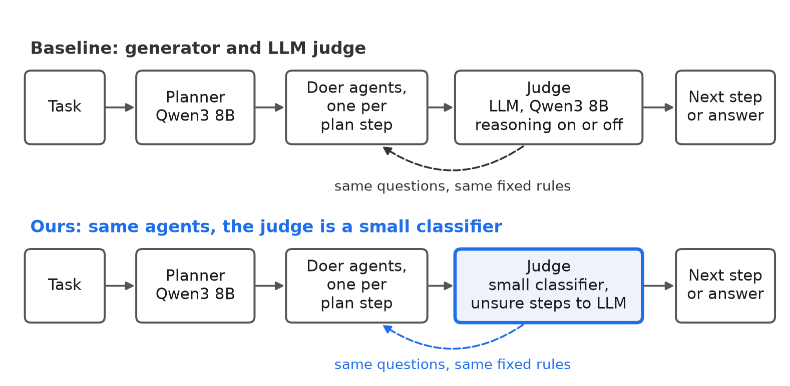
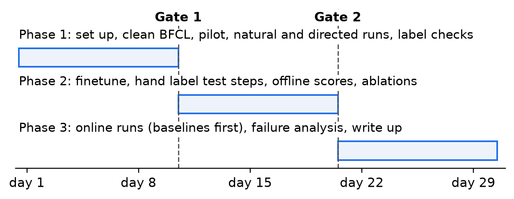

# Stay on Task: Can a small classifier correct local agents' drift?

LMA Group Project 2026, proposal. Team: lma major proj team. Shuban Biswas 2024111017, Ch Pavan Harshit 2025701057, Swayam Goyal 2024111012, Aaditya Sharma 2019113009.

## Problem and research question

Domain: multi agent systems that run on a normal computer and act through tools: files, messages, posts, bookings and trading accounts. The target user wants this private and cheap, so a big cloud model judging every step is out. Small local agents drift and hallucinate. Partway through a task they lose track of the request, make up values, claim work they never did and make risky calls nobody wanted. The usual fix is an LLM judge on every step, but a small model judging itself is weak [1] and a large judge is too slow and costly for every step. Tiny monitors tried so far struggled on real, unplanned mistakes [2].

**Why it matters.** On a personal machine the agents touch documents, messages and accounts, so one risky call can delete or leak something. Every wasted step costs time on slow hardware.

**Research question.** Can a small classifier, used as is or finetuned, judge each step for drift and hallucination better than an LLM judge, and what does that do to task accuracy and cost?

| | |
|---|---|
| Hypothesis | A finetuned classifier beats an LLM judge given the same state at catching drift and hallucination. Our full system completes more tasks than no judge and about as many as the generator and LLM judge baseline, for a fraction of its judge tokens. |
| Metrics | Detection: mean F1 of off track steps and false claims, the two classes rules cannot settle, against hand labels. Made up value and Q3 are reported per class as secondary. Tasks: share of BFCL tasks passed by its checker plus our empty turn check. AgentDojo is reported beside it, outside the claim. |
| Falsified if | Primary: the finetuned classifier does not beat the LLM judge by at least 5 F1 points with a 95% confidence interval above zero. Task claim, tested only if the primary holds: the full system does not beat no judge with a 95% interval above zero, or the lower end of its 95% interval against the LLM judge baseline is more than 5 accuracy points down. The margin is widened at Gate 1 if pass to pass disagreement on the 3 Qwen3 8B validation passes gives it under 80% power at parity over 3 runs per task. Other comparisons are secondary and Holm corrected. |

In simulation with 300 positives per class and no extra correlation within a scenario, a true gain of 9 F1 points passes this bar about 98% of the time, 7 points about 86% and exactly 5 points about half the time.

## What is missing

Existing step guards are 0.8B to 8B generative safety models that block rather than correct [4, 5, 6]. Small checkers each target a narrow risk: made up tool calls [7], unsupported claims [8, 9, 10] or injected instructions [11]. Step reward models rank candidates for best of N picking [12, 13]. A Laya head already picks actions in a browser agent [14] and Laya's card lists agent traces among its typed decisions [15]. We found no work that uses a sub 1B classifier as the judge of a multi agent pipeline, compared per question with an LLM judge.

## System

{: style="width:64%"}

The baseline is the standard generator and judge pattern [16]: for each user turn a planner writes a short plan, a doer carries out each step and a judge checks it, all Qwen3 8B [17]. In ours the judge is Laya [15], a 0.4B ModernBERT [18] typed decision model in the Jev style [19], used as is and fully finetuned. Full finetuning a 0.4B model fits one card in a few hours, lighter than LoRA on the 8B agent would be. Its state is 1,024 tokens, about 768 of them filled by code: current and earlier user requests, the turn plan, the proposed call or closing message, an evidence list saying where each value appears (request, tool output, tool docs or nowhere) and the last three calls with outputs cut short. The LLM judge gets the same state and the same labelling guide with a few worked examples per class. The judge sees each call before it runs, so a call flagged by Q1 or Q2 never executes.

Code handles what needs no model: an exact repeat of a failed call, the fixed list of irreversible tools and the evidence list. The classifier answers typed questions, one forward pass each, every answer a fixed option with a confidence:

| Question | Asked on | Options |
|---|---|---|
| Q1 Drift | every tool call and closing message | `on_track`, `off_track` |
| Q2 Hallucination | every tool call and closing message | `none`, `made_up_value`, `false_claim` (closing message only) |
| Q3 Needed | every irreversible call; dropped if the pilot finds too few | `needed`, `not_needed` |

The order is code checks, then Q1 and Q2, then Q3, so Q3 decides only calls Q1 passes. Fixed rules map answers to actions. All fine: the call runs. Q3 `not_needed`: ask the user. Off track or hallucination: block and give the same doer a fixed warning. A second flag in the turn: a fresh doer takes over from the last good step. Exact repeat: backtrack to before the loop. The environment is copied before every step, but rollback restores reversible calls only, as on a real machine. The error subtypes from the directed runs below are stored for analysis but are not outputs, so the heads stay small and per class counts stay high. In the full system, if the top confidence on Q1 or Q2 falls under a threshold set on validation, the step goes to the LLM judge with reasoning on, within a budget of 10, 20 or 30% of steps [20]. Confidences are calibrated by cross fitting on 200 hand labelled validation steps reweighted to the real mix of turns, with automatic labels only as a fallback. We read a sample of that reasoning to see when it fixes the classifier and when it breaks a right label.

| Capability | Why the problem needs it | Metric | Ablation |
|---|---|---|---|
| Finetuning | the classifier must learn our step errors | F1 per question | as is vs finetuned |
| Reasoning | hard steps need a judge that thinks | F1 against judge tokens | escalation budget, LLM picks the action |
| Agentic | planner and doers recover by warning, handover and backtrack | task accuracy, correct runs broken | correction actions |
| Tool calling | every step is a call or a claim about one, risky calls need permission | tool call accuracy, unneeded irreversible calls run unasked | Q3 vs asking on every irreversible call |

**Expected novelty.** The first per question comparison of a sub 1B judge with an LLM judge and plain rules; a confidence gated cascade that gives a cost against accuracy curve; and step labels from directed runs confirmed by replay and code checks, released with the hand labelled steps.

## Task sets

**BFCL multi turn [21], cleaned.** 200 scenarios in 4 versions each over 8 domains: files, messages, posts, tickets, travel, trading, car and maths. 27 of the 200 base tasks fail for all 18 reported models and at least 10 have unsound answer keys [22]. We pin one commit, rewrite or drop only the unsound tasks and keep hard but sound ones. BFCL never checks turns whose correct answer is to call nothing (the missing function and missing parameter versions skip empty gold turns), so we add our own check: on such a turn any state changing call or invented value fails it. We split by scenario: 100 held out for test, whatever remains after cleaning for training, 15 of those kept for validation.

**AgentDojo benign tasks [23].** 97 user tasks with no injections, state checked by AgentDojo's own utility functions. It is used only as an outside check on task accuracy and is out of domain: no finetuning or threshold tuning on it, and its irreversible tool list is written per suite. tau2 bench is out: an agent that does nothing passes 23 of its 50 airline tasks [24] and it needs a second LLM as the user.

## Training data and labels

**Directed runs (new).** A stronger model acts as the doer in the same BFCL environments with the same planner and tool docs, on training scenarios only: Qwen3 32B in 4 bit, split over 4 Ada cards since its 19.3 GB of weights leave too little cache room on 2. Clean runs solve the task. Directed runs tell it to commit exactly one error of a named type at a named step and otherwise behave normally, with every type spread over every domain that has a fitting tool:

| Error type | Injected as | Confirmed by |
|---|---|---|
| Drift | wrong target, extra unrequested reversible state change, goal swapped for a related one, early stop | BFCL replay: no ending of reference calls passes the turn |
| Made up value | invented id, path, name or number, a withheld parameter filled in instead of asking | evidence list says nowhere |
| False claim | success reported after a failed or missing call, a tool result that never came back | BFCL fails the turn, or the claimed result is absent from the trace |
| Unneeded irreversible | delete, send, sell or book the request did not need | call is in no reference solution |

Each step is labelled as it is generated: earlier steps are on track if replay still passes just before the directed step (else the turn is dropped) and later steps in that turn are left out. The directed step gets one label per question from the checks: Q1 from replay (a false claim closing message stays on track for Q1, as in natural runs), Q2 from the evidence list or the claim check, Q3 from the reference solutions, independent of Q1. An unneeded irreversible call also fails replay, so Q1 blocks most of them and Q3 is the backstop for the rest. In a closing message false claim beats made up. A drift step that passes replay is relabelled on track and any other step that fails its check is dropped. Before training we hand check 50 directed steps per error type to see the stronger model really did what it was told. Target: 600 directed steps per type.

**Natural runs.** Qwen3 8B (3 passes) and Qwen3 4B (1 pass) run turn by turn, every turn starting from the correct state, and stay in training with automatic labels. After each call we replay every order kept subset of the turn's reference calls (up to 8) as an ending, and the first call after which none passes is off track [25]. In turns whose correct answer is to call nothing, reads are on track and the first state changing call or invented value is off track. Steps after an off track call are left out, as in directed runs. Otherwise a closing message in a failed turn is a false claim (on track for Q1) if it reports a success the trace does not show and off track if not. Made up: a value with no evidence that differs from the reference, simple arithmetic on tool outputs counting as evidence. Q3: an irreversible call in no reference solution is not needed. Each rule is hand checked on 50 steps for each of the 7 options (Q1 2, Q2 3, Q3 2), 350 in all, and fixed if right less than 80% of the time. The first validation pass is the pilot. Gate 1 needs at least 300 training examples per error class, at least 100 of them natural.

**Test labels.** Test data is natural Qwen3 8B errors only, never directed runs. From 3 recorded test passes we label by hand every step of randomly picked failed turns up to the first off track call, as in training, plus whole passed turns up to 500 steps, shuffled together, until off track and false claim each reach 300 positives, about 2,000 to 3,000 steps. With the 200 validation steps and all checks this is about 20 to 26 hours per person. Test F1 is also reported reweighted to the real mix of turns. Labellers follow one written guide and see neither the automatic labels nor the BFCL verdict. A fifth is labelled twice for Cohen's kappa.

## Judges, baselines and what we compare

Online on whole tasks: no judge, plain rules (no evidence is made up, a success word with no matching successful call is a false claim, a call not in the plan is drift, ask on every irreversible call), the LLM judge baseline (reasoning on), Laya as is, Granite Guardian 3.2 3B A800M [7] as a second off the shelf small judge, Laya finetuned alone and our full system. Offline only, on the same hand labelled steps: the LLM judge without reasoning or with the full trace, Qwen3 14B in 4 bit as a stronger reference, LettuceDetect [10] for token level hallucination in closing messages and Kev 0.8B [27], an open Jev style model below chance on When2Call [28] by its own card, so only a reference point. Granite Guardian covers only Q2 (function call risk on calls, groundedness risk on closing messages) and LettuceDetect only Q2 on closing messages. Each judge is scored only on the classes it can express, and online the questions it cannot express fall back to the plain rules. Tool call accuracy is the share of state changing calls after which the turn can still pass. When a system asks, the scripted user always approves, so we report ask precision and the share of unneeded irreversible calls blocked or asked about.

| Comparison | Measured by | Where |
|---|---|---|
| Every judge per question; as is vs finetuned | F1, precision and recall per class against hand labels; any flag F1 on the wrong steps of AgentProcessBench [26] and AgentHallu [3] | offline |
| State parts: drop the plan, trace or evidence list | F1, also on turns with 3 or more reference calls (14% of call turns, 405 of 2,924 by our count) | offline, 3 finetunes |
| Escalation budget 0, 10, 20, 30, 100% | F1 against judge tokens | offline |
| Directed runs in training or not; Q1 answer fed to Q2 or not | F1 on natural test errors | offline, 2 finetunes |
| All online systems | task accuracy (BFCL and AgentDojo), tool call accuracy, unneeded irreversible calls run unasked, tokens and time per task | online |
| Correction actions: warn only, fresh doer only, all, LLM picks | task accuracy, correct runs a correction broke | online, 1 run each |

Confidence intervals come from a bootstrap over scenarios. Everything is scored by code or hand labels, never an AI grader. We read every miss and false alarm of the finetuned classifier and the LLM judge and group them by cause.

## Compute, timeline and risks

Ada server: RTX 2080 Ti cards with 11 GB, up to 4 at a time, plus our own machines. Qwen3 8B in 4 bit and every small judge fit on one card, served with vLLM. Hours are estimates until measured speed numbers and the pilot's token counts arrive at Gate 1.

GPU hours: setup, cleaning and pilot 4; natural training runs 15; directed runs with Qwen3 32B about 40 card hours (10 h on 4 cards, plans reused from the natural runs); test passes and all offline judges 21; finetunes for the main model, ablations and seeds 24; online BFCL 111 (LLM judge baseline 40, full system 16 and 11 each for no judge, plain rules, Laya as is, Granite Guardian and Laya finetuned alone); online AgentDojo for 7 systems with 3 runs 30; correction action ablation 16. Total about 260, 320 with reruns, about 3 days on 4 cards. No paid API.

{: style="width:56%"}

**Gates.** Gate 1: class counts and label checks pass, hours redone from measured numbers. Gate 2: escalation budget and thresholds fixed on validation.

**Risks.** Too few natural errors: more 4B passes and directed runs for training, a fourth test pass. Directed runs unlike natural errors: the directed runs ablation shows it and training falls back to natural runs. States over 768 tokens: finetune with a longer window, ModernBERT reads up to 8,192. Hand labelling runs long: failed turns first, passed turn steps cut to 300. Ada busy or vLLM slow on the 2080 Ti: our own GPUs or llama.cpp, then 2 runs per task instead of 3.

**Data and safety.** Public task sets, no personal data, simulated tools only; hand labels are released.

**Beyond the core study.** If time allows we try background OS tasks such as filing documents and mail triage, where a sub 1B judge can run beside an always on agent and leave a readable audit trail.

## References

1. CRITICTOOL: evaluating self critique of LLMs in tool calling error scenarios, arXiv 2506.13977.
2. Real time detection and repair of LLM agent failures, arXiv 2608.02464.
3. AgentHallu: benchmarking automated hallucination attribution of LLM based agents, arXiv 2601.06818.
4. StepGuard: learning step level guardrails, arXiv 2608.24777.
5. SAFETY SENTRY: context aware human intervention via execute, ask, refuse routing, arXiv 2607.13594.
6. AgentDoG: a diagnostic guardrail framework for AI agent safety and security, arXiv 2601.18491.
7. Granite Guardian, arXiv 2412.07724, with its 3.2 3B A800M model card.
8. MiniCheck: efficient fact checking of LLMs on grounding documents, arXiv 2404.10774.
9. Vectara HHEM 2.1, model card, huggingface.co/vectara/hallucination_evaluation_model.
10. LettuceDetect: hallucination detection for RAG, arXiv 2502.17125.
11. LlamaFirewall and PromptGuard 2, arXiv 2505.03574.
12. ToolRM: outcome reward models for tool calling LLMs, arXiv 2509.11963.
13. AgentPRM: process reward models for LLM agents, arXiv 2511.08325.
14. laya browser, Laya step decision head for a browser agent, huggingface.co/cklxx/laya-browser.
15. Laya typed decision model, model card, huggingface.co/convaiinnovations/laya.
16. Zheng et al., Judging LLM as a judge with MT Bench and Chatbot Arena, arXiv 2306.05685.
17. Qwen3 Technical Report, arXiv 2505.09388.
18. ModernBERT: a modern bidirectional encoder, arXiv 2412.13663.
19. TypeSafe, Jev and System One models, docs.typesafe.ai.
20. Chen et al., FrugalGPT: how to use large language models while reducing cost and improving performance, arXiv 2305.05176.
21. Patil et al., The Berkeley Function Calling Leaderboard (BFCL), ICML 2025.
22. BFCL answer key issues 1367, 1267, 1137 and 1377, github.com/ShishirPatil/gorilla.
23. AgentDojo, arXiv 2406.13352.
24. tau2 bench issue 384, github.com/sierra-research/tau2-bench.
25. Wang et al., Math Shepherd: verify and reinforce LLMs step by step without human annotations, arXiv 2312.08935.
26. AgentProcessBench: step level process quality in tool using agents, arXiv 2603.14465.
27. Kev 0.8B, model card, huggingface.co/jaredpalmer/kev-0.8b.
28. When2Call: when (not) to call tools, arXiv 2504.18851.
