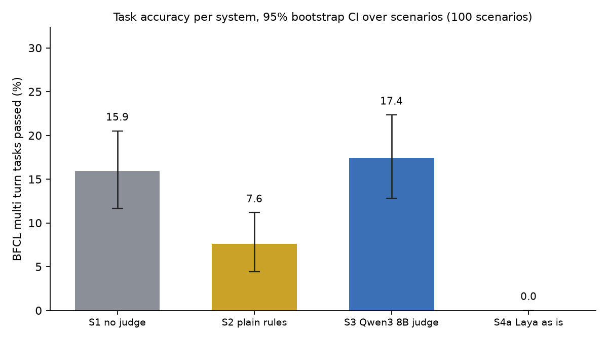
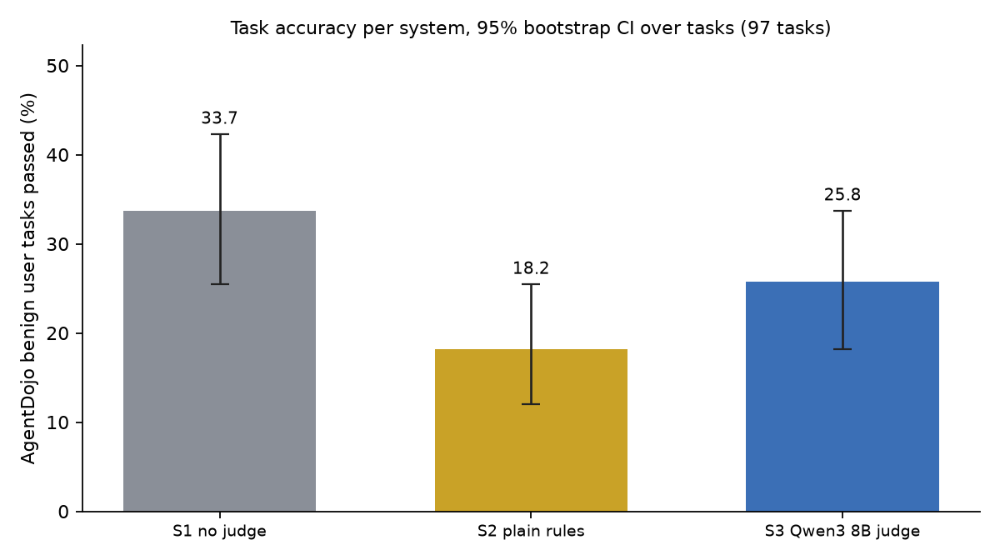
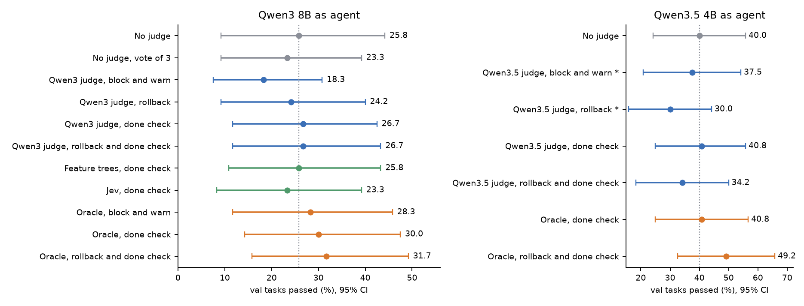

## 1. Setup

Planner and doer agents run on vLLM on one Ada RTX 2080 Ti per run. Benchmarks are BFCL multi turn (cleaned, with our empty turn check: a state change on a turn whose gold is empty fails) and AgentDojo benign user tasks. BFCL test is 100 held out scenarios in 4 versions (base, miss_param, miss_func, long_context) with 3 runs each. AgentDojo is 97 tasks with 3 runs each. Validation is 15 separate scenarios in 4 versions with 2 runs, 120 tasks, used for every tuning decision. Pass means the benchmark's own state checker. CIs are 95% bootstrap over scenarios. Speed on one card: cold prefill 3,700 tok/s, decode 80 tok/s for one stream and about 350 tok/s in total at 8 concurrent agents. Systems: S1 no judge, S2 plain rules, S3 Qwen3 8B judge with reasoning, S4a Laya typed decisions, S4b Granite Guardian.

## 2. Baselines on the test sets (full runs)

| System | BFCL pass % [CI] | vs S1, points | AgentDojo pass % [CI] | vs S1, points |
|---|---|---|---|---|
| S1 no judge | 15.9 [11.7, 20.5] | | 33.7 [25.4, 42.3] | |
| S2 plain rules | 7.6 [4.4, 11.2] | -8.3 [-11.8, -5.2] | 18.2 [12.0, 25.4] | -15.5 [-22.7, -8.6] |
| S3 Qwen3 8B judge | 17.4 [12.8, 22.3] | +1.5 [-0.6, +3.8] | 25.8 [18.2, 33.7] | -7.9 [-13.1, -3.1] |

S3 is the only judge that does not hurt on BFCL, and the gain sits inside the noise at twice the time per task. Out of domain on AgentDojo it blocks 2.6 steps per task and loses 7.9 points. Laya as is passed 0 of 133 runs (stopped, upper bound 2.2%) because it blocked 87.6% of judged steps and every run hit the 20 step cap. Granite Guardian answered risky call for all 169 calls in its 20 task pilot and flagged none of 52 closing messages, so it also passed 0.

## 3. Off the shelf judges, offline

Labels come from our oracle (section 7). Gold replay steps count as good. Validation has only 20 flagged calls and 20 flagged messages, so every AUROC below carries a wide interval. Kev and LettuceDetect were scored differently, on 200 half passed half failed tasks per system, against task failure.

| Judge | Reads | AUROC |
|---|---|---|
| Kev 0.8B, LettuceDetect v2 | calls and messages, closing messages | 0.48 to 0.63 (task level), Kev flags about 75% of all steps |
| Laya, 18 variants and a logistic head | calls and messages | 0.39 to 0.67 |
| Skywork Reward V2 0.6B, 1.7B, 4B | calls and messages | 0.44 to 0.53, pair accuracy 58.0 to 60.7% on multi turn pairs |
| ToolPRM GRPO v4 | candidate pairs | pair accuracy 34.2% on multi turn pairs, below chance |
| Qwen3.5 4B judge | calls and messages | 0.28 calls, 0.50 messages, parsed only 51% under a 1536 token cap |
| Qwen3 8B judge | calls, messages | 0.70, 0.49 |
| Jev (hosted classifier) | calls, closing messages | 0.53, 0.81 |
| Feature trees we trained from scratch | calls, closing messages | 0.76, 0.83 (train F1 far above val, so they overfit) |

Only closing message checks by Jev and the trees, and Qwen3 8B on calls, show any signal. Laya fails twice. It keeps the start of its text state and cuts the end, so on long states it never saw the proposed step. Its made up value question also flags 98% of closing messages, and 100% of known good gold replay messages. Moving the step first removed the first problem and added no signal.

## 4. Why block and warn does not help

On the first 120 task pilot (token limit 8192) the oracle judge, which sees the reference replay and flags every wrong call and false closing claim, ties S1 at 20.8%. S1 repeated on the same tasks differs by 4.2 points, so differences under about 5 points are noise. The oracle gave a block to 44 tasks and only 4 of them passed. The other 47 failures had no block at all, because the agent stopped early or skipped a call, and a judge of the proposed step cannot see something that never happened. When a step is blocked, a warning plus a fresh doer rarely finds the right step.

## 5. Correction actions on the validation set

Modes: rollback drops the flagged step from context and resamples (up to 2 times). Deep rollback also drops the turn's trailing failed calls. Vote of 3 draws three steps and judges only on disagreement. Done check, applied when the doer closes a turn, asks whether the request is finished and if not drops the closing message and says part of the request may be unfinished. Oracle rows are ceilings and not deployable. Context limit here is 20,480 tokens, so S1 differs slightly from section 4.

<figure><figcaption>Validation pass rate per mode, 120 tasks, 95% CI. Dotted line is no judge. Orange is the oracle ceiling, green are judges from section 3. A star marks Qwen3.5 judge rows cut by a 1536 token reasoning cap, rerun is in the final jobs.</figcaption></figure>

Rollback removes the damage block and warn did (Qwen3 judge 18.3 to 24.2) but no deployable judge beats S1 by more than noise on either agent. Qwen3 8B: judge with done check +0.8 [-7.5, +9.2], Jev -2.5, trees 0.0. Qwen3.5 4B: judge with done check +0.8 [-5.8, +8.3]. Only the oracle with rollback and done check clears the noise, +5.8 [0.0, +12.5] on Qwen3 8B and +9.2 [+2.5, +15.8] on Qwen3.5 4B. Vote of 3 gave nothing (23.3 against 25.8). Rollback plus done check with the Qwen3 judge costs 418 s per task against 162 for no judge, and the Qwen3.5 judge version hit the step cap in 20 tasks. The agent model matters more than any judge so far: Qwen3.5 4B with no judge scores 40.0 against 25.8 for Qwen3 8B, and is faster (101 s against 162 s per task).

## 6. What this means for the proposal

Block and warn actions hurt, even with a perfect judge. Rollback plus a turn end done check is the only lever that moved results. Questions about one proposed step (Q1 to Q3) cannot see omissions, which are most of the failures. The F1 detection claim is untested here, since it needs annotator labels we do not have. A judge only helps if it learns the done or not done call at turn end well enough to match the oracle, which is a training problem.

## 7. For the finetuning work

1. Add a turn end label, request done or not done, next to the per step labels. It is the label behind the only gain.
2. Labels can be made automatically on any task that has a reference replay. Our oracle flags a call off track when it makes every ending of the turn's reference calls miss the reference end state, flags a closing message false when it claims success while the state is wrong, and marks a turn done when the end state matches and every reference function was called. It was applied to 3,824 recorded steps from no judge runs on 89 train and validation scenarios, plus 3,635 gold replay steps as good examples. We can share both sets and the oracle script.
3. Put the proposed step first in the input. Laya truncates the end of the state, and untuned it flags almost every closing message.
4. Do not expect a prompt change to fix it: Jev and feature trees on closing messages (0.81, 0.83), and Qwen3 8B on calls (0.70), are the only signal found, everything else sits at chance.
5. Oracle flags are rare, 220 of 3,824 steps (5.8%: 109 of about 2,390 calls, 111 of about 1,430 closing messages), and all sit in failed tasks. Balance or weight the classes and keep false flags on gold replay under 5%.

## 8. Next

Final test runs on BFCL (100 scenarios, 4 versions) and AgentDojo (97 tasks) are running on Ada (1 run per task) for S1, the Qwen3 judge with done check, and the oracle ceiling with rollback and done check, on both agent models. Results are expected tonight, around 19:00 IST. The final write up will replace the validation numbers here with test numbers.
